<div align="center">

# HyMaC-Net

### A Hybrid Lightweight Mamba–CNN Framework with Patch Embedding for Medical Image Classification

[](https://github.com/tanvirul-islam-rifat/HyMaCNet--medical-image-classification/actions/workflows/ci.yml)


**Sourav Das · Shibam Chakraborty · Sakibul Hasan Turja · Md. Tanvirul Islam Rifat**

Supervisor **Dr. Amitabha Chakrabarty** · Co-supervisor **Nirjhor Datta**
Department of Computer Science and Engineering, BRAC University

[Thesis PDF](docs/HyMaC-Net_BSc_Thesis_BRACU_2025.pdf) · [Method](docs/METHOD.md) · [Results data](results/) · [Model card](docs/MODEL_CARD.md) · [Reproducibility](docs/REPRODUCIBILITY.md) · [Cite](#citation)

</div>

---

Medical image classifiers have to be accurate, cheap enough for hospital hardware and robust to data from a different scanner. CNNs see texture but little global context; Vision Transformers add global context at quadratic cost and need large labelled datasets. **HyMaC-Net** combines a texture-preserving **CNN stem**, a compact **4 × 4 patch embedding** (49 tokens) and three **Mamba selective state-space blocks**, which mix global context in time linear in the number of tokens. A fused average–max pooling head and a mid-network **auxiliary classifier** stabilise training.

The design came out of a **22-step ablation study** that shrank an initial 138 M-parameter model to 20.5 M while raising PathMNIST accuracy from 89.0 % to 94.0 %. Two sizes are evaluated on **12 benchmarks across 6 imaging modalities**, with a 5-seed significance test against ResNet-50, a cross-dataset test on brain MRI and Grad-CAM inspection.

<p align="center"></p>

## Highlights

| | |
|---|---|
| **Small and cheap** | HyMaC-Net-S: **9.4 M parameters, 1.26 GFLOPs**. HyMaC-Net-B: 20.5 M, 2.36 GFLOPs. |
| **Accuracy for its size** | Across 9 MedMNIST datasets, HyMaC-Net-S averages **88.5 %**, on par with MedViT-S (88.4 %) at **2.5× fewer parameters and 3.9× less compute**. |
| **Best on Kvasir** | **83.4 %** on 8-class GI endoscopy, **+4.1 points** over the best compact baseline cited (MedMamba-T, 79.3 %). |
| **Top-tier on X-ray and blood cells** | CPN X-ray **97.5 %** and BloodMNIST **98.3 %**, level with MedMamba-S at 41 % of its parameters. |
| **Statistically tested** | Over 5 paired seeds on PathMNIST, HyMaC-Net-B beats ResNet-50 on **every seed** (+2.89 points, exact Wilcoxon one-sided *p* = 1/32). |
| **Generalises across datasets** | Trained on BRISC-25, tested on an independent brain-tumour MRI set: **75.4 %** vs 64.1 % (ResNet-50) and 60.0 % (ViT-B/16). |

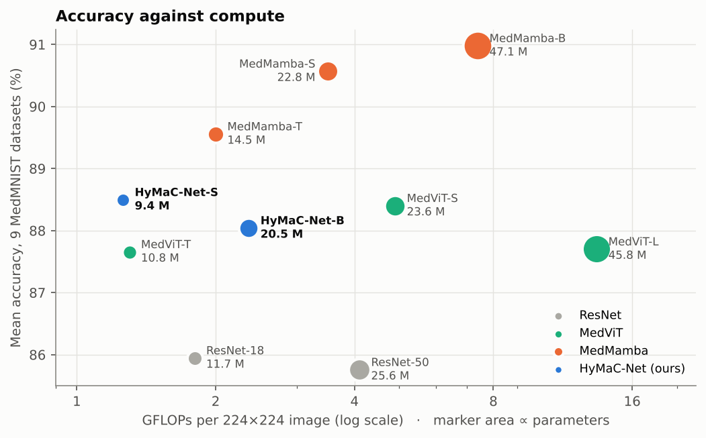

The chart averages accuracy over the nine MedMNIST datasets that every model reports (TissueMNIST is excluded because MedMamba does not report it). HyMaC-Net-S sits on the low-compute end of the frontier. MedMamba is more accurate at higher cost: MedMamba-T gains 1.1 points for 1.6× the compute.

## Method in Brief

<p align="center">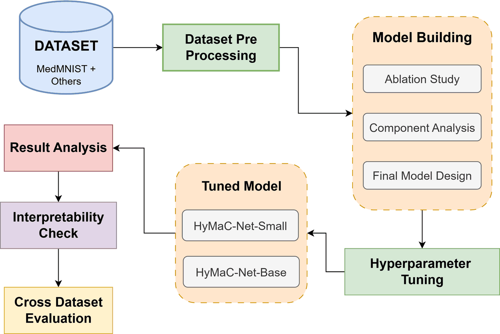</p>

| Stage | What it does | Output |
|---|---|---|
| **CNN stem** | Conv 7×7/2 → AvgPool 3×3/2 + DropBlock → Conv 3×3/2 → Conv 3×3/1, each with BatchNorm + GELU | 64 × 28 × 28 |
| **Patch embedding** | Conv with kernel = stride = 4, plus a learned 7 × 7 positional grid | 49 tokens × D |
| **Mamba encoder** | 3 × VisionMamba block: LN → Mamba-SSM → Dropout (+ residual), LN → MLP (4D) (+ residual) | 49 × D |
| **Auxiliary head** | Average-pooled tokens after block 1 → LN → GELU → Dropout → Linear | aux logits |
| **Main head** | ½(global average + global max pool) → LN → GELU → Dropout → Linear(128) → GELU → Dropout → Linear | main logits |
| **Fusion** | ŷ = ŷ_main + 0.3 · ŷ_aux, one loss on the fused logits | class scores |

| Variant | Embedding D | Mamba blocks | Parameters | GFLOPs | Use |
|---|---|---|---|---|---|
| **HyMaC-Net-S** | 512 | 3 | 9.4 M | 1.26 | screening, binary and well-structured tasks, low-resource hardware |
| **HyMaC-Net-B** | 768 | 3 | 20.5 M | 2.36 | multi-class, texture-heavy tasks |

Equations, every layer and the training recipe are in [`docs/METHOD.md`](docs/METHOD.md).

### How the design was found

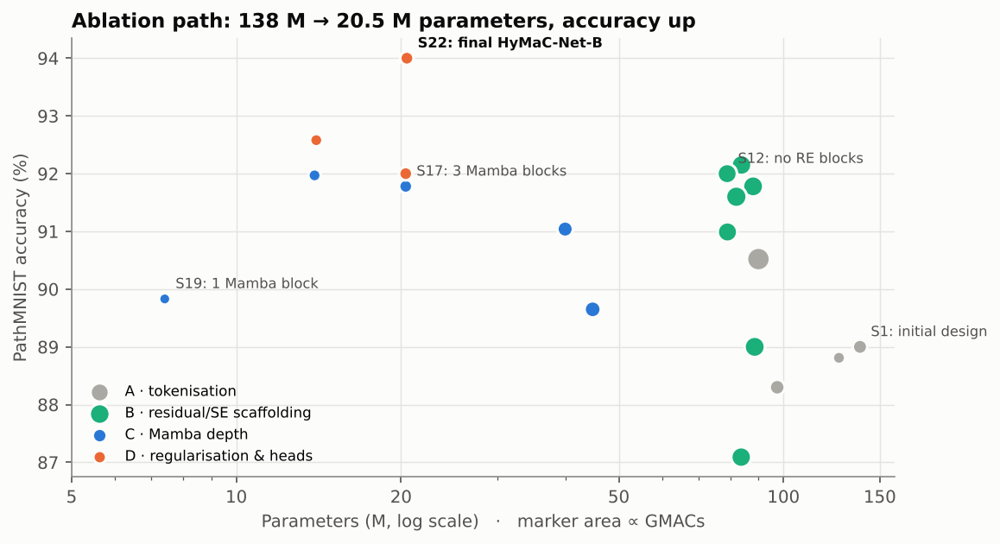

All ablations ran on PathMNIST (full table: [`results/ablation_pathmnist.csv`](results/ablation_pathmnist.csv)).

| Phase | Varied | Finding |
|---|---|---|
| **A · Tokenisation** | no patching; patch 28 / 14 / 7 | Patching beats no patching; finer patches add accuracy and compute. A stronger stem (224 → 28) with patch 4 bounds the cost at 49 tokens. |
| **B · Scaffolding** | Residual-SE blocks before/after patching; ASPP | Once the stem and positional grid are in place, SE blocks and ASPP add cost but no accuracy. Removed (S12: 78.9 M, 92.0 %). |
| **C · Mamba depth** | 6 → 3 → 2 → 1 blocks | With only 49 tokens, 3 blocks are enough: 20.4 M parameters, 91.8 %. One block loses robustness. |
| **D · Regularisation and heads** | dropout, avg–max pooling fusion, auxiliary head | Each adds a small, steady gain at no extra token or depth cost: **94.0 % at 20.5 M (S22, final)**. |
| **Mixer swap** | Linformer instead of Mamba | Linformer needs more depth for the same stability (37.2 M for 93.0 %); Mamba kept. |

## Results

Accuracy figures in this repository are computed from the released **confusion matrices** ([`results/confusion_matrices/`](results/confusion_matrices/)) and from the support-weighted recall of each result row, which equals accuracy by definition. Where the printed thesis tables differ, this repository follows the confusion matrices; the forthcoming paper will carry the same corrected figures. Every number is checked automatically ([Verification](#verification)).

### Twelve benchmarks

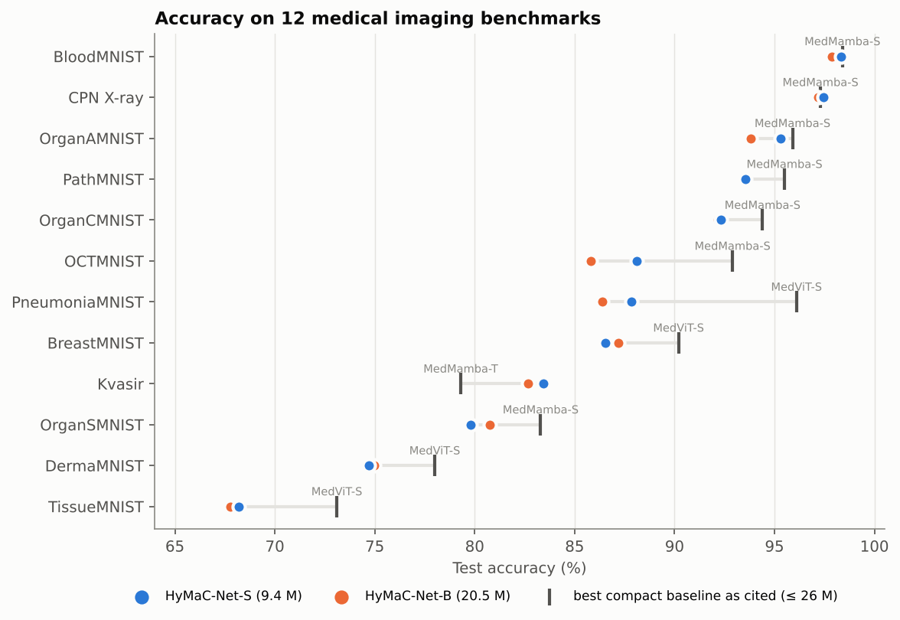

| Dataset | Modality | Classes | HyMaC-Net-S | HyMaC-Net-B | AUC (S / B) | Best compact baseline cited |
|---|---|---|---|---|---|---|
| BloodMNIST | Blood cell microscopy | 8 | **98.33** | 97.87 | 0.999 / 0.999 | 98.4 MedMamba-S |
| CPN X-ray | Chest X-ray | 3 | **97.45** | 97.20 | 0.998 / 0.998 | 97.3 MedMamba-S |
| OrganAMNIST | Abdominal CT, axial | 11 | **95.32** | 93.81 | 0.998 / 0.998 | 95.9 MedMamba-S |
| PathMNIST | Colon pathology | 9 | **93.55** | 93.45 | 0.991 / 0.991 | 95.5 MedMamba-S |
| OrganCMNIST | Abdominal CT, coronal | 11 | **92.31** | 92.17 | 0.996 / 0.996 | 94.4 MedMamba-S |
| OCTMNIST | Retinal OCT | 4 | **88.10** | 85.80 | 0.985 / 0.980 | 92.9 MedMamba-S |
| PneumoniaMNIST | Paediatric chest X-ray | 2 | **87.82** | 86.38 | 0.976 / 0.970 | 96.1 MedViT-S |
| BreastMNIST | Breast ultrasound | 2 | 86.54 | **87.18** | 0.895 / 0.886 | 90.2 MedViT-S |
| Kvasir | GI endoscopy | 8 | **83.42** | 82.67 | 0.983 / 0.983 | 79.3 MedMamba-T |
| OrganSMNIST | Abdominal CT, sagittal | 11 | 79.78 | **80.74** | 0.980 / 0.979 | 83.3 MedMamba-S |
| DermaMNIST | Dermatoscopy | 7 | 74.71 | **74.96** | 0.905 / 0.917 | 78.0 MedViT-S |
| TissueMNIST | Kidney cortex cells | 8 | **68.19** | 67.79 | 0.928 / 0.930 | 73.1 MedViT-S |

Accuracy in %. "Compact" = ResNet-18/50, MedViT-T/S and MedMamba-T/S (≤ 26 M parameters); baseline values are as published by their authors and cited in the thesis, not re-run here. Precision, recall, F1, specificity and Cohen's κ for every dataset: [`results/per_dataset_small.csv`](results/per_dataset_small.csv), [`results/per_dataset_base.csv`](results/per_dataset_base.csv). Per-class metrics: [`results/derived/per_class_metrics.csv`](results/derived/per_class_metrics.csv).

**Reading the table.** The Small model is the better default: it matches or beats the Base model on 9 of 12 datasets at less than half the size. HyMaC-Net leads on Kvasir, matches the strongest compact models on BloodMNIST and CPN X-ray, and trails MedMamba and MedViT on several MedMNIST sets, most clearly PneumoniaMNIST and OCTMNIST. Its case rests on accuracy per unit of compute rather than on the top score everywhere.

<details>
<summary><b>Confusion matrices, training curves and dataset samples</b></summary>

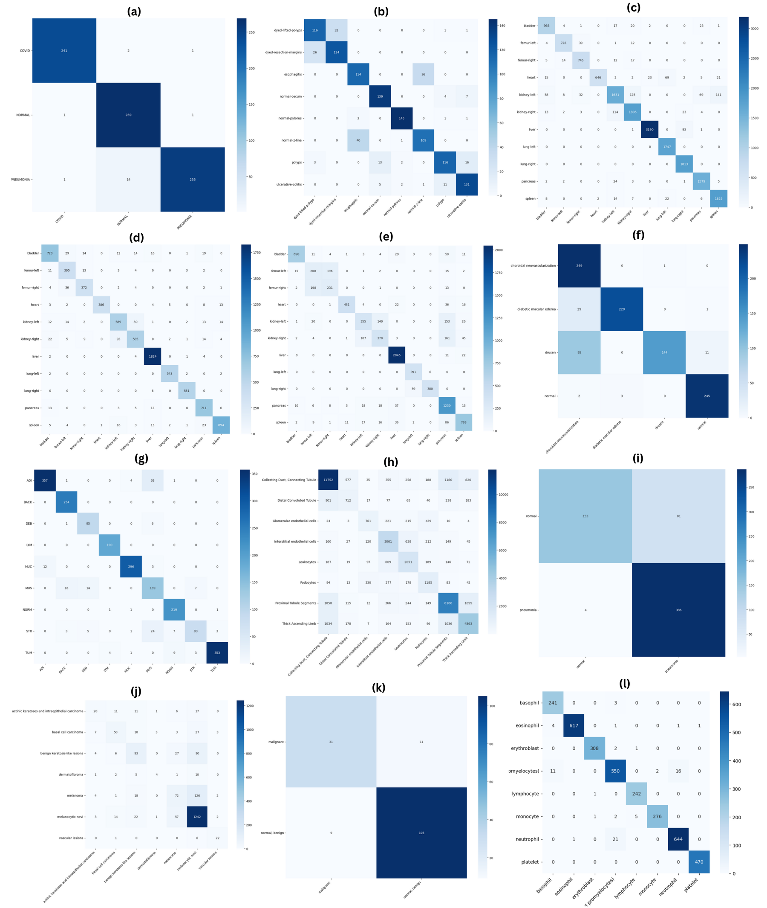
*HyMaC-Net-B on (a) CPN X-ray, (b) Kvasir, (c) OrganAMNIST, (d) OrganCMNIST, (e) OrganSMNIST, (f) OCTMNIST, (g) PathMNIST, (h) TissueMNIST, (i) PneumoniaMNIST, (j) DermaMNIST, (k) BreastMNIST, (l) BloodMNIST.*

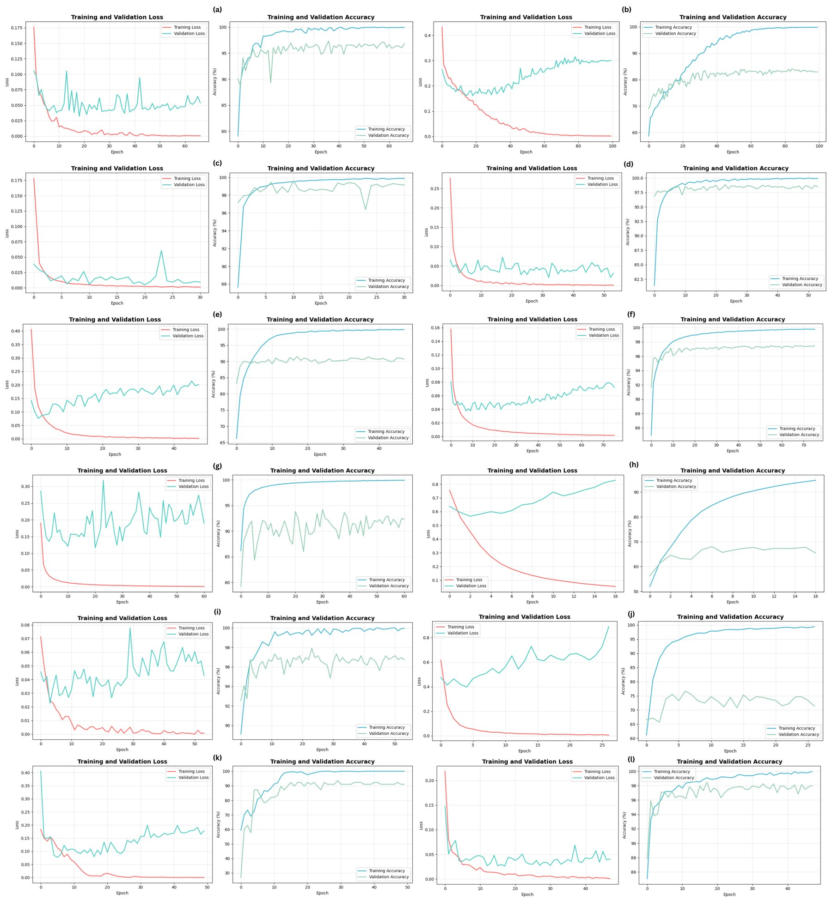
*Training and validation loss and accuracy, same dataset order.*

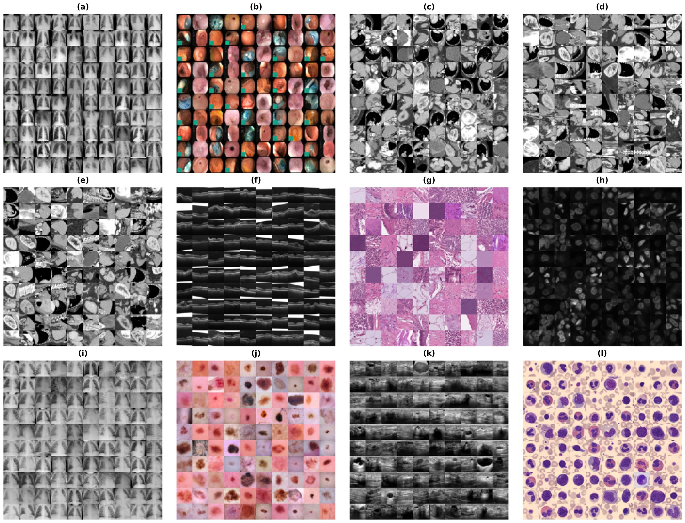
*Samples from the 12 datasets, same order.*

</details>

### Seed robustness

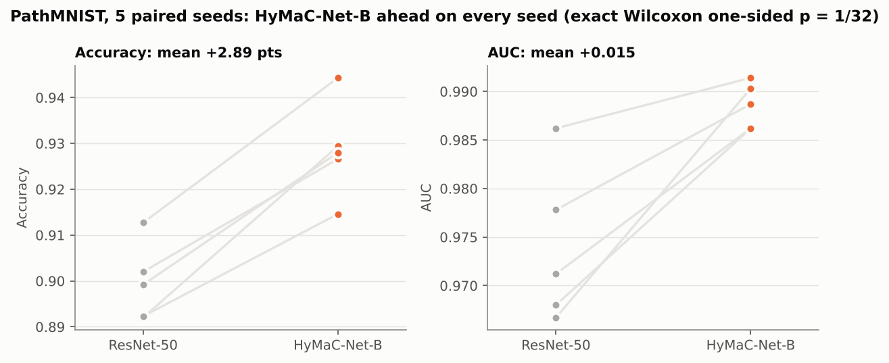

| PathMNIST, 5 seeds (7, 21, 42, 77, 99) | HyMaC-Net-B | ResNet-50 | Mean Δ | Exact Wilcoxon *p* (one / two-sided) |
|---|---|---|---|---|
| Accuracy | **0.9286 ± 0.0106** | 0.8996 ± 0.0085 | +0.0289 | 0.031 / 0.063 |
| F1 | **0.9259 ± 0.0113** | 0.8979 ± 0.0080 | +0.0281 | 0.031 / 0.063 |
| AUC | **0.9886 ± 0.0024** | 0.9740 ± 0.0081 | +0.0146 | 0.031 / 0.063 |

HyMaC-Net-B is ahead on all five seeds for every metric (rank-biserial effect size 1.0), and in accuracy its worst seed beats ResNet-50's best. With five pairs, 1/32 is the smallest one-sided *p* the test can produce; the two-sided test does not reach 0.05, so the directional result is the one to quote.

### Efficiency

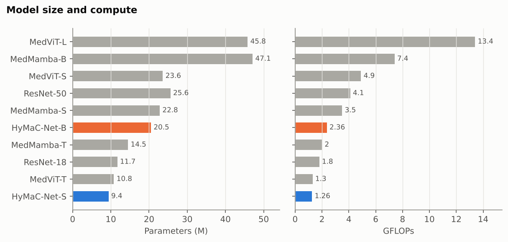

From the ablation runs on an RTX 4080 Super, the final Base model trains in about **190 s per PathMNIST epoch** (the initial design took about 800 s) and infers in **0.65 ms per image**.

### Cross-dataset generalisation

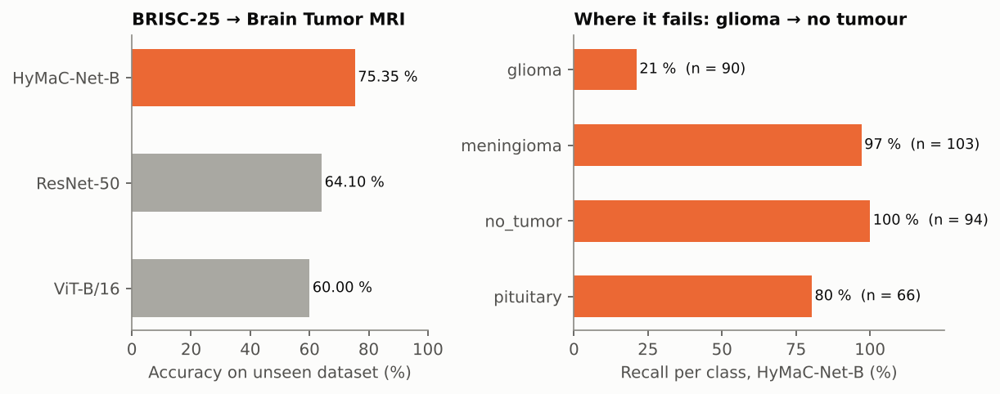

| Train on BRISC-25 (T1 MRI) → test on Brain Tumor MRI (353 images) | Accuracy | AUC | Macro-F1 |
|---|---|---|---|
| **HyMaC-Net-B** | **75.35** | **0.907** | **0.709** |
| ResNet-50 | 64.10 | 0.754 | 0.647 |
| ViT-B/16 | 60.00 | 0.700 | 0.593 |

HyMaC-Net-B keeps an AUC of 0.91 under domain shift, ahead of both baselines. The per-class view shows the limit: meningioma, no-tumour and pituitary transfer well, but **only 21 % of gliomas are recognised, and 54 % are predicted as "no tumour"**. That miss is the costliest kind in a clinical setting, and domain adaptation is the main item of future work.

<details>
<summary><b>Cross-dataset confusion matrix</b></summary>

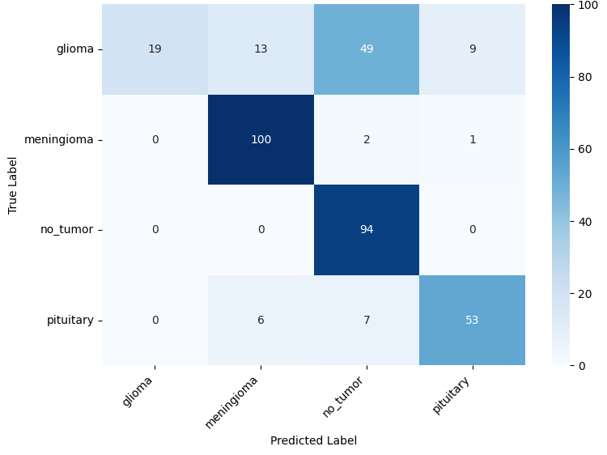

</details>

### Interpretability

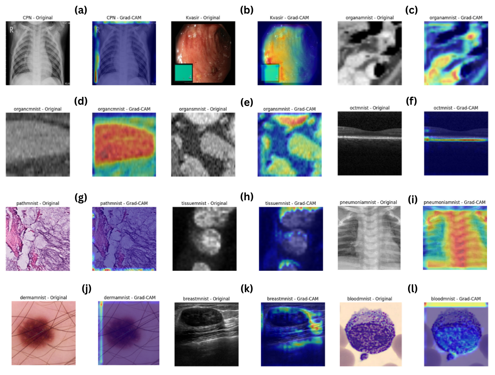

Grad-CAM heatmaps of HyMaC-Net-B, computed at the last convolutional layer before patch embedding, for one test image per dataset. On OrganAMNIST, OrganSMNIST, OCTMNIST and BreastMNIST the activations follow the organ, retinal-layer and lesion structures. On CPN X-ray, DermaMNIST, PathMNIST, TissueMNIST and BloodMNIST, part of the activation falls on image borders, and on Kvasir near the instrument overlay box. That pattern calls for a quantitative localisation check before any claim of clinical grounding; see the [model card](docs/MODEL_CARD.md).

## Verification

The model code is not public yet (see [Code Availability](#code-availability)), so this repository releases what can be checked: the confusion matrices, every result table as CSV, and a small standard-library tool that recomputes the metrics and tests their consistency on every push.

```
$ python -m tools.check_results
[PASS] HyMaC-Net-B: accuracy equals weighted recall in every row                  12 datasets
[PASS] HyMaC-Net-B: every F1 is attainable from its precision and recall          F1 <= (P + R) / 2
[PASS] HyMaC-Net-S: accuracy equals weighted recall in every row                  12 datasets
[PASS] HyMaC-Net-B accuracy matches the released confusion matrices               9 datasets
[PASS] HyMaC-Net-B Cohen's kappa matches the released confusion matrices          ok
[PASS] Confusion matrices cover the official MedMNIST v2 test splits              7 datasets
[PASS] Cross-dataset accuracy and macro-F1 match the released confusion matrix    75.35 % on 353 test images
[PASS] Seed means and SDs reproduce the thesis statistics (Table 5.7)             accuracy, F1, AUC
[PASS] Wilcoxon: all 5 seeds favour HyMaC-Net-B, exact one-sided p = 1/32         two-sided p = 0.0625
[PASS] results/derived/ is up to date with tools/metrics.py                       ok

14 passed, 0 failed          (excerpt)
```

The 12 unit tests in [`tests/`](tests/) also feed the checker deliberately corrupted results — an accuracy that contradicts its own recall or confusion matrix, an F1 no precision–recall pair can produce, a mistyped seed run — and confirm each is rejected.

```bash
git clone https://github.com/tanvirul-islam-rifat/HyMaCNet--medical-image-classification.git
cd HyMaCNet--medical-image-classification

python -m tools.check_results                     # consistency checks (Python 3.10+, no dependencies)
python -m tools.metrics                           # metrics recomputed from the confusion matrices
python -m unittest discover -s tests -t . -v      # 12 tests
pip install -r requirements.txt && python -m tools.make_figures   # redraw every chart in this README
```

## Datasets

| Dataset | Modality | Task | Images |
|---|---|---|---|
| PathMNIST | Colon pathology (H&E) | 9 classes | 107,180 |
| DermaMNIST | Dermatoscopy | 7 classes | 10,015 |
| OCTMNIST | Retinal OCT | 4 classes | 109,309 |
| PneumoniaMNIST | Paediatric chest X-ray | binary | 5,856 |
| BreastMNIST | Breast ultrasound | binary | 780 |
| BloodMNIST | Blood cell microscopy | 8 classes | 17,092 |
| TissueMNIST | Kidney cortex cells | 8 classes | 236,386 |
| OrganAMNIST · OrganCMNIST · OrganSMNIST | Abdominal CT, 3 planes | 11 classes | 58,850 · 23,660 · 25,221 |
| CPN X-ray | Chest X-ray: COVID-19 / normal / pneumonia | 3 classes | 5,228 |
| Kvasir | GI endoscopy | 8 classes | 4,000 |
| BRISC-25 → Brain Tumor MRI | Brain MRI (cross-dataset) | 4 classes | 6,000 → 7,023 |

All public. MedMNIST v2 sets use the official splits at 224 × 224; CPN X-ray and Kvasir are split 70 / 15 / 15. Class imbalance is handled with class-weighted loss, Focal loss (γ = 2) and label smoothing (ε = 0.1) rather than oversampling.

## Training Setup

| | |
|---|---|
| **Optimiser** | AdamW, lr 1e-4, weight decay 1e-2, cosine annealing |
| **Loss** | Focal (γ = 2.0) on 10 datasets; cross-entropy with label smoothing 0.1 on CPN X-ray and Kvasir |
| **Regularisation** | Dropout 0.15, DropBlock 0.15, auxiliary-head weight 0.3 |
| **Schedule** | Batch 32, up to 100 epochs, early stopping with patience 10, best-validation checkpoint |
| **Per-dataset tuning** | Only the learning rate (0.75× or 1.5×) and the loss, kept only if ≥ 0.5 macro-F1 points over seeds 7 / 21 / 42 |
| **Precision** | Mixed precision (`torch.cuda.amp`) |
| **Hardware** | Intel i7-14700K, RTX 4080 Super 16 GB, 64 GB DDR5; Kaggle 2 × Tesla T4 |
| **Stack** | PyTorch 2, `mamba-ssm` |

Per-dataset settings: [`results/training_config.csv`](results/training_config.csv).

## Repository Structure

```
├── README.md
├── docs/
│   ├── HyMaC-Net_BSc_Thesis_BRACU_2025.pdf   # full thesis (74 pages)
│   ├── METHOD.md                             # architecture equations, layers, training recipe
│   ├── MODEL_CARD.md                         # intended use, limitations, risks
│   ├── REPRODUCIBILITY.md                    # what is released, what is not, and when
│   └── images/                               # architecture, figures, charts
├── results/
│   ├── confusion_matrices/                   # HyMaC-Net-B on 12 benchmarks + cross-dataset (JSON)
│   ├── per_dataset_small.csv · per_dataset_base.csv
│   ├── baselines_medmnist.csv · baselines_other.csv · efficiency.csv
│   ├── ablation_pathmnist.csv · strategy_20_vs_21.csv · seeds_pathmnist.csv
│   ├── cross_dataset.csv · training_config.csv · datasets.csv
│   └── derived/                              # generated: metrics and per-class tables, seed statistics
├── tools/
│   ├── metrics.py                            # metrics from confusion matrices, exact Wilcoxon test
│   ├── check_results.py                      # consistency checks (CI)
│   └── make_figures.py                       # every chart in this README
├── tests/                                    # 12 unit tests incl. corrupted-data tests
├── CITATION.cff
├── LICENSE.md
└── .github/workflows/ci.yml
```

## Code Availability

Training code and trained weights are withheld until the associated paper is published, and will be released here under an open licence at that point. Until then:

- the architecture is specified layer by layer in [`docs/METHOD.md`](docs/METHOD.md) and the thesis (Algorithms 1–3);
- every hyperparameter, seed and per-dataset setting is in [`docs/REPRODUCIBILITY.md`](docs/REPRODUCIBILITY.md) and [`results/`](results/);
- code and weights are available to reviewers on request.

## Limitations

- **Weighted averages flatter imbalanced sets.** On DermaMNIST the support-weighted F1 is 0.73, but the macro-F1 from the confusion matrix is 0.52: minority lesion types are often missed. Per-class numbers are in [`results/derived/`](results/derived/).
- **Baselines are cited, not re-run.** Their numbers come from the original papers, whose input resolution and protocols may differ. Only ResNet-50 and ViT-B/16 were trained under the same protocol, on PathMNIST and the cross-dataset test.
- **One run per dataset** except the 5-seed PathMNIST study; differences under about one point on the smaller test sets are within run-to-run variation.
- **Cross-dataset recall for glioma is 21 %.** Not suitable for screening without domain adaptation.
- **Grad-CAM is qualitative** and shows border activations on several datasets.
- **2-D only**, single-label classification; no 3-D volumes, segmentation or calibration analysis.
- **Research use only** — not a medical device and not clinically validated.

## Citation

```bibtex
@thesis{das2025hymacnet,
  title       = {{HyMaC-Net}: A Hybrid Lightweight Mamba-{CNN} Framework with Patch Embedding for Medical Image Classification},
  author      = {Das, Sourav and Chakraborty, Shibam and Turja, Sakibul Hasan and Rifat, Md. Tanvirul Islam},
  school      = {BRAC University},
  department  = {Department of Computer Science and Engineering},
  type        = {B.Sc. thesis},
  year        = {2025}
}
```

GitHub's **Cite this repository** button uses [`CITATION.cff`](CITATION.cff). The paper citation will be added on publication.

## Acknowledgements

We thank our supervisor **Dr. Amitabha Chakrabarty** and co-supervisor **Nirjhor Datta** for their guidance, and the creators of **MedMNIST v2**, **Kvasir**, **CPN X-ray**, **BRISC-25** and the **Brain Tumor MRI** dataset for making their data public.

## Authors

| Name | Student ID |
|---|---|
| Sourav Das | 24341223 |
| Shibam Chakraborty | 24241278 |
| Sakibul Hasan Turja | 24341222 |
| Md. Tanvirul Islam Rifat | 22101311 |

Repository maintained by **Md. Tanvirul Islam Rifat** — [GitHub](https://github.com/tanvirul-islam-rifat) · [LinkedIn](https://www.linkedin.com/in/tanvirul-islam-rifat)

<div align="center"><sub>B.Sc. in Computer Science and Engineering · CSE400 Thesis · BRAC University · 2025</sub></div>
