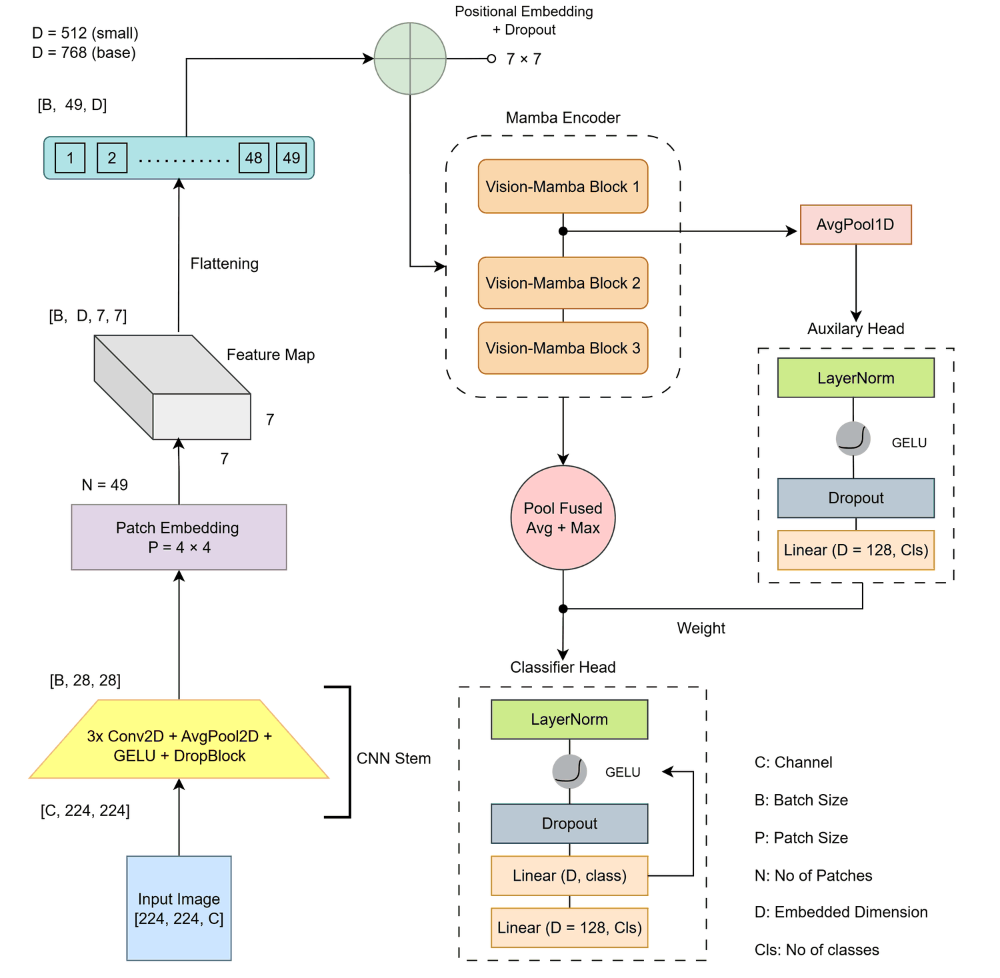
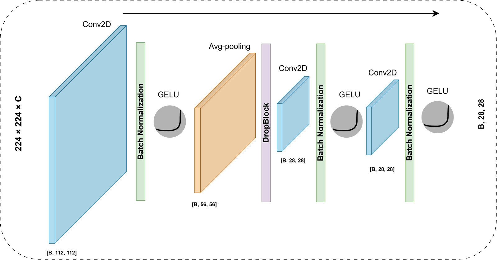
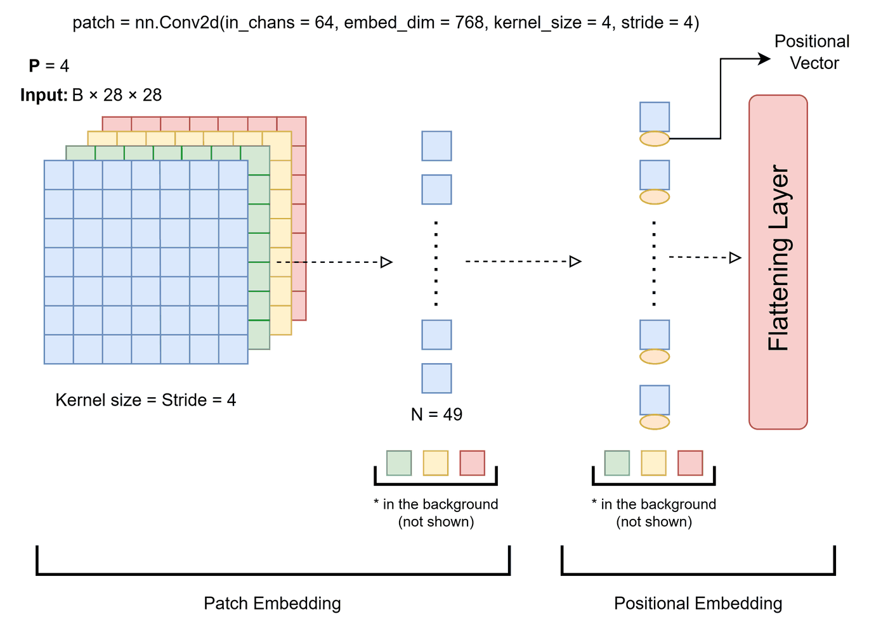
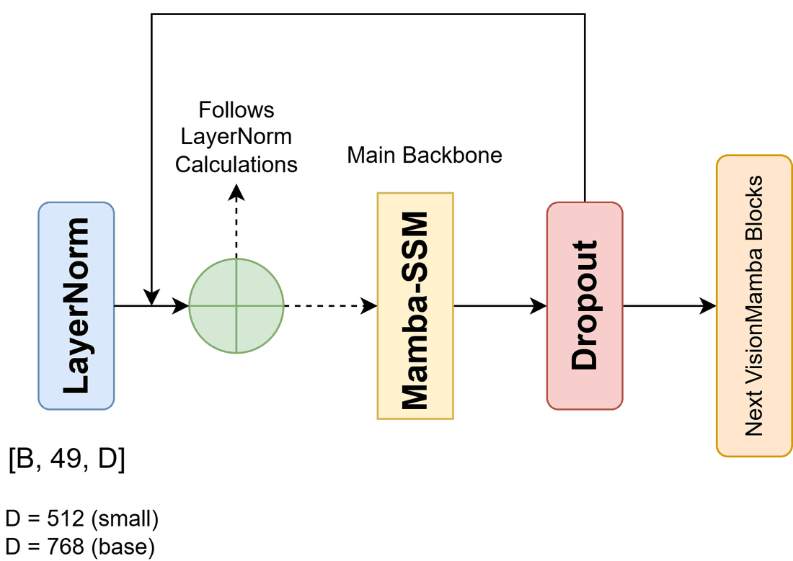
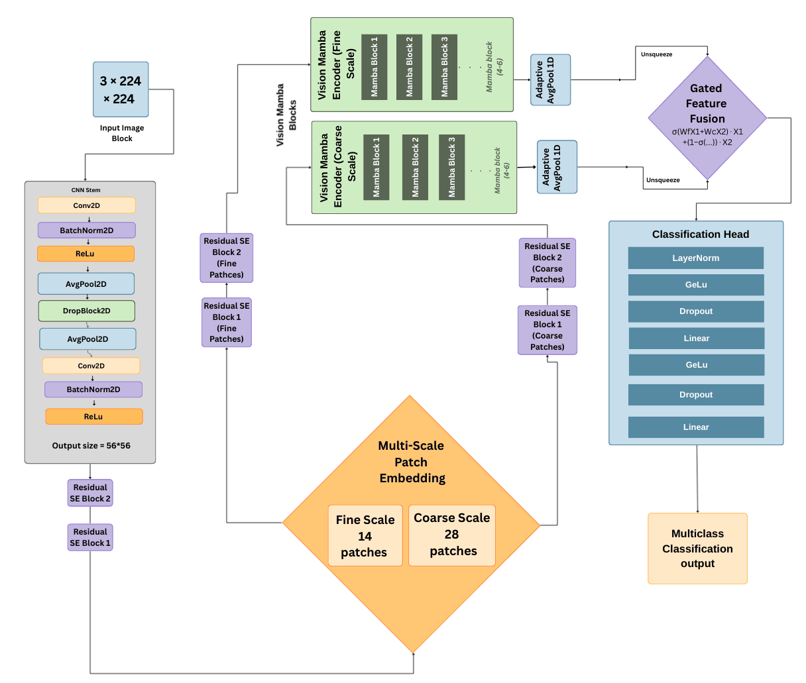

# HyMaC-Net — Method

This document specifies HyMaC-Net layer by layer, as described in Chapter 4 of the [thesis](HyMaC-Net_BSc_Thesis_BRACU_2025.pdf). It is enough to re-implement the model; the authors' code follows on publication (see [REPRODUCIBILITY.md](REPRODUCIBILITY.md)).



## Notation

| Symbol | Meaning |
|---|---|
| $B$ | batch size |
| $C \in \{1, 3\}$ | input channels (grayscale or RGB) |
| $D$ | token embedding width: 512 (Small) or 768 (Base) |
| $L = 49$ | number of tokens (7 × 7 grid) |
| $N = 3$ | number of VisionMamba blocks |
| $K$ | number of classes |
| $\lambda = 0.3$ | auxiliary-head fusion weight |

## 1. CNN stem: 224 × 224 → 28 × 28



The stem injects a convolutional inductive bias and downsamples by 8 before any token is formed, so the sequence mixer always operates on a fixed, small grid while low-level texture (edges, cell and tissue boundaries) is preserved.

$$
\begin{aligned}
s_1 &= \mathrm{GELU}\big(\mathrm{BN}(\mathrm{Conv}_{7\times7,\,s=2}(x))\big) &&\in \mathbb{R}^{B\times 64\times 112\times 112}\\
s_2 &= \mathrm{DropBlock}\big(\mathrm{AvgPool}_{3\times3,\,s=2}(s_1)\big) &&\in \mathbb{R}^{B\times 64\times 56\times 56}\\
s_3 &= \mathrm{GELU}\big(\mathrm{BN}(\mathrm{Conv}_{3\times3,\,s=2}(s_2))\big) &&\in \mathbb{R}^{B\times 64\times 28\times 28}\\
s_4 &= \mathrm{GELU}\big(\mathrm{BN}(\mathrm{Conv}_{3\times3,\,s=1}(s_3))\big) &&\in \mathbb{R}^{B\times 64\times 28\times 28}
\end{aligned}
$$

DropBlock uses drop probability 0.15.

## 2. Patch embedding and positional grid: 28 × 28 → 49 tokens



A strided convolution with kernel = stride = 4 turns the 28 × 28 map into a 7 × 7 token grid:

$$
P = \mathrm{Conv}_{4\times4,\,s=4}(s_4) \in \mathbb{R}^{B\times D\times 7\times 7},
\qquad X_0 = \mathrm{reshape}(P) \in \mathbb{R}^{B\times L\times D}.
$$

A learned 2-D positional grid $E_{pos} \in \mathbb{R}^{1\times D\times 7\times 7}$ is bicubically interpolated to the token grid $(G_h, G_w)$ — the identity at 224 × 224 input — flattened and added, followed by dropout:

$$
X_0 \leftarrow \mathrm{Dropout}\Big(X_0 + \mathrm{reshape}\big(\mathcal{I}_{\text{bicubic}}(E_{pos};\,G_h, G_w)\big)\Big).
$$

## 3. Mamba encoder: three VisionMamba blocks



Each block is pre-normalised for both the sequence mixer and the MLP, with residual connections:

$$
\begin{aligned}
Y &= X + \mathrm{Dropout}\big(\mathcal{M}(\mathrm{LN}(X))\big)\\
X' &= Y + \mathrm{MLP}(\mathrm{LN}(Y)), \qquad \mathrm{MLP}(z) = W_2\,\mathrm{Dropout}\big(\mathrm{GELU}(W_1 z)\big),\; W_1\in\mathbb{R}^{D\times 4D},\, W_2\in\mathbb{R}^{4D\times D}
\end{aligned}
$$

$\mathcal{M}$ is the Mamba selective state-space layer from the `mamba-ssm` library: input-dependent gating with a causal depthwise convolution over the token axis and a selective scan whose cost is linear in $L$. With $L = 49$ tokens, three blocks give stable global mixing across all twelve datasets; deeper stacks added cost without accuracy (ablation Phase C).

## 4. Heads and fusion

**Auxiliary head** — after block $\lfloor N/2 \rfloor = 1$, tokens are average-pooled and classified:

$$
a = \mathrm{GAP}(X_1) \in \mathbb{R}^{B\times D},\qquad
\hat y_{aux} = W_{aux}\,\mathrm{Dropout}\big(\mathrm{GELU}(\mathrm{LN}(a))\big) \in \mathbb{R}^{B\times K}.
$$

**Main head** — fused average and max pooling over the final tokens, then a two-layer MLP with width 128:

$$
z = \tfrac12\big(\mathrm{GAP}(X_N) + \mathrm{GMP}(X_N)\big),\qquad
\hat y_{main} = W_{m2}\,\mathrm{Dropout}\Big(\mathrm{GELU}\big(W_{m1}\,\mathrm{Dropout}(\mathrm{GELU}(\mathrm{LN}(z)))\big)\Big),
$$

with $W_{m1}\in\mathbb{R}^{D\times128}$ and $W_{m2}\in\mathbb{R}^{128\times K}$.

**Fusion** — one loss is computed on the fused logits:

$$
\hat y = \hat y_{main} + \lambda\,\hat y_{aux},\qquad \lambda = 0.3 .
$$

Average pooling captures diffuse evidence and max pooling concentrated evidence; the auxiliary head feeds gradient to the first block and stabilised training on imbalanced datasets.

## 5. Loss

Label-smoothed cross-entropy ($\varepsilon = 0.1$) or Focal loss ($\gamma = 2$), chosen per dataset (see [`results/training_config.csv`](../results/training_config.csv)), with class weights inversely proportional to class frequency in the training split:

$$
\mathcal{L}_{CE+LS} = -(1-\varepsilon)\log p_{y^*} - \frac{\varepsilon}{K}\sum_{c=1}^{K}\log p_c,
\qquad
\mathcal{L}_{Focal} = -(1-p_{y^*})^{\gamma}\log p_{y^*}.
$$

## 6. Training and inference

```
initialise θ;  best ← 0;  wait ← 0
for epoch = 1 … 100:
    for (x, y) in train:                       # AdamW, lr 1e-4, wd 1e-2, batch 32, AMP
        loss ← criterion(HyMaCNet(x; θ), y)    # fused logits ŷ_main + 0.3·ŷ_aux
        update θ
    cosine-annealing step
    acc ← accuracy(argmax HyMaCNet(x; θ), y) on validation
    if acc > best: save θ*, best ← acc, wait ← 0
    else: wait ← wait + 1; if wait ≥ 10: stop
predict:  ŷ = argmax softmax(HyMaCNet(x; θ*))
```

## 7. Variants and cost

| | HyMaC-Net-S | HyMaC-Net-B |
|---|---|---|
| Embedding width $D$ | 512 | 768 |
| Blocks $N$ / tokens $L$ | 3 / 49 | 3 / 49 |
| Parameters | 9.4 M | 20.5 M |
| Compute (224 × 224) | 0.63 GMAC = 1.26 GFLOPs | 1.18 GMAC = 2.36 GFLOPs |

Both variants share one topology. Because $L$ is fixed at 49, cost grows with $D$ (the MLP is $4D$ wide) and with depth; the stem's cost is fixed by its 28 × 28 operating point.

## 8. From the initial design to HyMaC-Net



The starting point (138 M parameters) used multi-scale patch embedding (fine 14 and coarse 28 patches), two 6-block Mamba encoders, Residual-SE blocks around tokenisation and gated feature fusion. The four ablation phases on PathMNIST ([`results/ablation_pathmnist.csv`](../results/ablation_pathmnist.csv)) removed what did not pay for itself:

1. **Tokenisation (A).** One scale, patch 4 on a 28 × 28 stem output: 49 tokens bound the mixer's cost.
2. **Scaffolding (B).** Residual-SE blocks and ASPP removed — the stem and positional grid already supply the spatial bias.
3. **Depth (C).** 12 → 3 Mamba blocks: 20.4 M parameters at almost no accuracy cost.
4. **Regularisation and heads (D).** Dropout lowered, average–max pooling fusion and the auxiliary head added: 94.0 % on PathMNIST at 20.5 M parameters.

Strategy 20 (3 blocks) was preferred over strategy 21 (2 blocks) because it generalised better across the other MedMNIST datasets ([`results/strategy_20_vs_21.csv`](../results/strategy_20_vs_21.csv)). A Linformer mixer was tried in place of Mamba and needed more depth for the same stability, so Mamba was kept.
